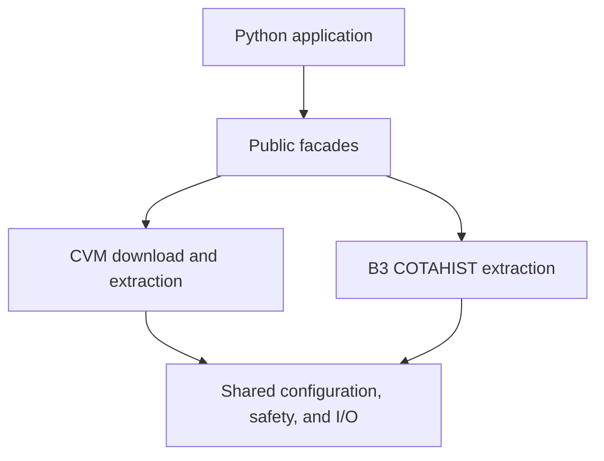

# Architecture

Global-Data-Finance is a Python library consumed by applications. It receives
caller selections, files, and paths; it returns structured results and Parquet
artifacts. Current sources are CVM and B3.

## Where to start in the code

Paths below are relative to `src/globaldatafinance/`.

| Responsibility | Location |
| --- | --- |
| Public exports | `__init__.py`: `FundamentalStocksDataCVM`, `HistoricalQuotesB3`, `ExtractionResultB3` |
| Facade validation and orchestration | `application/cvm_docs/` and `application/b3_docs/` |
| CVM behavior | `brazil/cvm/fundamental_stocks_data/` |
| B3 behavior | `brazil/b3_data/historical_quotes/` |
| Configuration, logging, retry, and safety | `core/` |
| Generic I/O and recoverable publication | `macro_infra/` |
| Shared base exceptions | `macro_exceptions/` |

For CVM, start at `client.py` and `http.py`; conversion is in `csv_pipeline/`
and publication in `transaction.py`. For B3, `catalog.py` resolves inputs,
`source_validation/` and `cotahist_parser/` validate and interpret records,
and `extraction_service/` and `parquet_writer/` coordinate output.

## Data flows

**CVM:** the facade validates the request, resolves document/year selections,
and calls the HTTP adapter. The ZIP is validated and retained. When requested,
extraction converts CSVs in staging, checks content, and publishes the Parquet
batch.

**B3:** the facade resolves local `COTAHIST_A{YYYY}.ZIP` or
`COTAHIST_A{YYYY}.TXT` files. The extractor accepts ZIP and TXT; it validates
each source and every record before filtering, processes batches, merges the
Parquet, and verifies output before publication.

Presentation belongs to `*_formatter.py` modules in `application/`.
Orchestrators coordinate collaborators; validation and transformation should
not incorporate I/O that belongs to adapters.

## Contracts a change must preserve

- **API:** public imports, signatures, defaults, results, and exceptions.
  CVM uses `DownloadResultCVM`; B3 uses `ExtractionResultB3`. Check partial
  failure diagnostics rather than relying only on the absence of exceptions.
- **CVM:** retained ZIPs and Parquet `string` columns under `exact-text-v1`.
- **B3:** annual COTAHIST names, every requested year, complete default
  selection, and Parquet schema v2. Coexisting ZIP/TXT inputs require
  equivalent content. `fast` uses bounded concurrency; `slow` uses one worker.
- **Safety:** validate inputs, ZIPs, names, and destinations before creating
  directories or writing. Source-specific rules stay within their source.
- **Publication:** `macro_infra/transactional_publication/` provides staging,
  a journal, lock, backups, and recovery; sources retain parsing, schemas, and
  validation. Recovery does not authorize removing caller files or guarantee
  simultaneous batch visibility for concurrent readers.

Persistence and recovery details belong to the
[technical reference](api-reference.md) and
[publication protocol](../reference/transactional-publication.md).

## Organize a change

CVM and B3 have different needs and may use different internal organizations.
Move a responsibility to `core/`, `macro_infra/`, or `macro_exceptions/` when it
is actually shared. Avoid creating interfaces, layers, or re-exports merely
to make sources uniform.

A new source needs a complete delivery: source implementation, a facade in
`application/`, a public export, behavior tests, and documentation in Portuguese
and English. Keep dependencies acyclic and restrict `__init__.py` to explicit
exports.

Tests mirror public, source, and shared boundaries. Their subdirectories
organize topics; they do not create runtime layers. See [testing](testing.md)
and [contributing](contributing.md) to validate a change.

## Read further when needed

| Topic | Reference |
| --- | --- |
| Fields, results, and exceptions | [CVM API](../reference/cvm-api.md) · [B3 API](../reference/b3-api.md) |
| B3 persistence | [Schema v2](../reference/b3-schema-v2.md) |
| ZIP and path safety | [Limits and UNC decision](../decisions/archive-safety-and-unc.md) |
| Ingestion evolution | [PyArrow and integrity decision](../decisions/pyarrow-ingestion-integrity-cutover.md) |
| Shared infrastructure | [Consolidation decision](../decisions/shared-infrastructure-clean-cut.md) |
