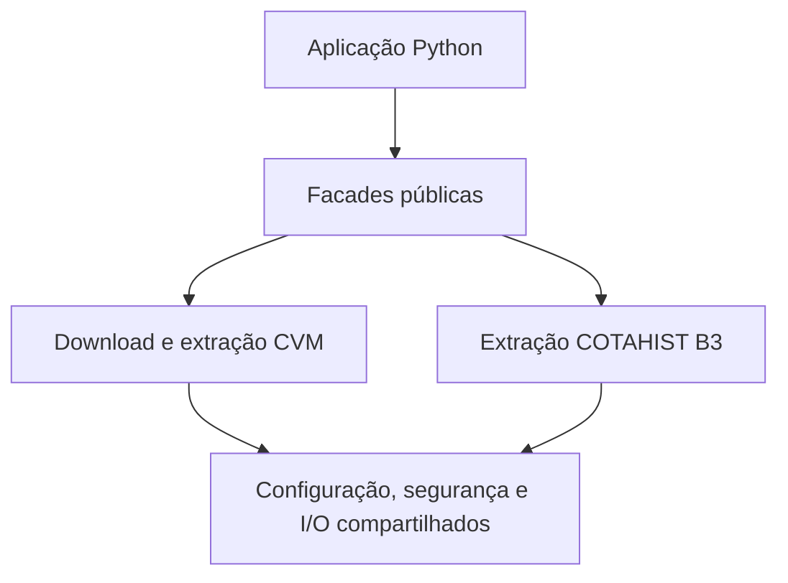

# Arquitetura

Global-Data-Finance é uma biblioteca Python consumida por aplicações. Recebe
seleções, arquivos e caminhos do chamador; devolve resultados estruturados e
artefatos Parquet. As fontes atuais são CVM e B3.

## Onde começar no código

Os caminhos abaixo são relativos a `src/globaldatafinance/`.

| Responsabilidade | Local |
| --- | --- |
| Exports públicos | `__init__.py`: `FundamentalStocksDataCVM`, `HistoricalQuotesB3`, `ExtractionResultB3` |
| Validação e orquestração das facades | `application/cvm_docs/` e `application/b3_docs/` |
| Comportamento CVM | `brazil/cvm/fundamental_stocks_data/` |
| Comportamento B3 | `brazil/b3_data/historical_quotes/` |
| Configuração, logging, retry e segurança | `core/` |
| I/O genérico e publicação recuperável | `macro_infra/` |
| Exceções-base compartilhadas | `macro_exceptions/` |

Na CVM, comece por `client.py` e `http.py`; a conversão fica em `csv_pipeline/`
e a publicação em `transaction.py`. Na B3, `catalog.py` resolve as entradas,
`source_validation/` e `cotahist_parser/` validam e interpretam os registros,
e `extraction_service/` e `parquet_writer/` coordenam a saída.

## Fluxos de dados

**CVM:** a facade valida a solicitação, resolve documento/ano e chama o adapter
HTTP. O ZIP é validado e preservado. Quando solicitada, a extração converte os
CSVs em staging, confere o conteúdo e publica o lote de Parquets.

**B3:** a facade resolve arquivos locais `COTAHIST_A{YYYY}.ZIP` ou
`COTAHIST_A{YYYY}.TXT`. O extrator aceita ZIP e TXT; valida cada fonte e todos
os registros antes do filtro, processa os lotes, consolida o Parquet e verifica
a saída antes da publicação.

A apresentação pertence aos módulos `*_formatter.py` em `application/`.
Orquestradores coordenam colaboradores; validação e transformação não devem
incorporar I/O que pertença aos adapters.

## Contratos que uma mudança deve preservar

- **API:** imports públicos, assinaturas, padrões, resultados e exceções.
  CVM usa `DownloadResultCVM`; B3 usa `ExtractionResultB3`. Confira os
  diagnósticos de falha parcial, não apenas a ausência de exceção.
- **CVM:** ZIPs retidos e colunas Parquet `string` no contrato `exact-text-v1`.
- **B3:** nomes anuais COTAHIST, todos os anos pedidos, seleção completa por
  padrão e schema Parquet v2. ZIP/TXT coexistentes exigem conteúdo equivalente.
  `fast` usa concorrência limitada; `slow` usa um worker.
- **Segurança:** valide entradas, ZIPs, nomes e destinos antes de criar
  diretórios ou escrever. Regras específicas permanecem na fonte.
- **Publicação:** `macro_infra/transactional_publication/` oferece staging,
  journal, lock, backups e recuperação; a fonte mantém parser, schema e
  validação. A recuperação não autoriza remover arquivos do chamador nem
  garante visibilidade simultânea do lote para leitores concorrentes.

Os detalhes de persistência e recuperação pertencem à
[referência técnica](api-reference.md) e ao
[protocolo de publicação](../reference/transactional-publication.md).

## Organizar uma alteração

CVM e B3 têm necessidades diferentes e podem ter organizações internas
diferentes. Extraia uma responsabilidade para `core/`, `macro_infra/` ou
`macro_exceptions/` quando ela for compartilhada de fato. Evite criar interfaces,
camadas ou re-exports para uniformizar fontes sem necessidade.

Uma fonte nova precisa de uma entrega completa: implementação na área da fonte,
facade em `application/`, export público, testes espelhando o comportamento e
documentação em português e inglês. Preserve dependências sem ciclos e
`__init__.py` restritos a exports explícitos.

Os testes espelham as fronteiras públicas, de fonte e compartilhadas. Seus
subdiretórios organizam assuntos; não criam camadas de runtime. Consulte
[testes](testing.md) e [como contribuir](contributing.md) para validar a mudança.

## Aprofundar quando necessário

| Assunto | Referência |
| --- | --- |
| Campos, resultados e exceções | [API CVM](../reference/cvm-api.md) · [API B3](../reference/b3-api.md) |
| Persistência B3 | [Schema v2](../reference/b3-schema-v2.md) |
| Segurança de ZIP e caminhos | [Decisão sobre limites e UNC](../decisions/archive-safety-and-unc.md) |
| Evolução da ingestão | [Decisão PyArrow e integridade](../decisions/pyarrow-ingestion-integrity-cutover.md) |
| Infraestrutura compartilhada | [Decisão de consolidação](../decisions/shared-infrastructure-clean-cut.md) |
